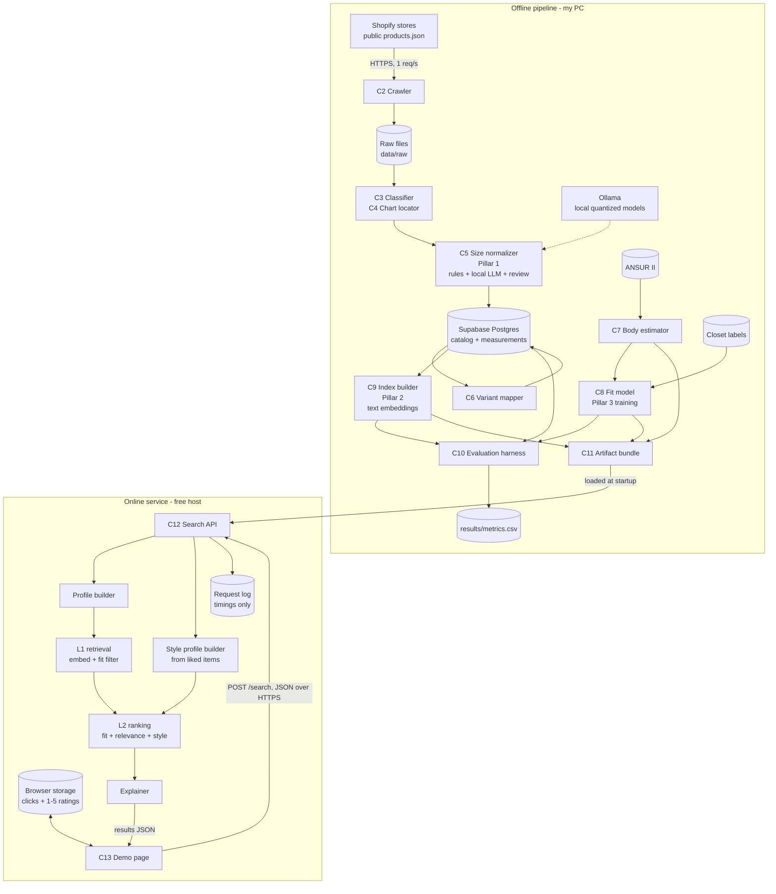

# Ai-Clothing-Recommendation: High-Level Design

Oct 21, 2026 · @Samay Kapdia

**Status:** planning draft v0.3 (style personalization added; matches SPEC v1.1). This HLD feeds `docs/SPEC.md` and Claude Code plan mode, which will decide file-level details. Anything marked *(provisional)* is expected to change.

**How to read it:** every section opens with an *In plain words* summary for non-technical readers, followed by the technical detail.

## 1. Executive Summary & Core Objectives

*In plain words:* a size label like "Medium" means something different at every clothing brand. Ai-Clothing-Recommendation reads each brand's size chart, converts every size into real measurements in centimetres, and lets a shopper search across stores. Results are ranked by how well they match the search, how likely each size is to fit that shopper, and how close each item is to styles the shopper has liked before, with a one-line reason such as "Get the L; the M will be short."

**Origin:** Every brand sizes differently, so buying from a new store is a guess.

**Design anchor:** Shopify's Semantic Search (Vantage), a two-stage system: broad retrieval (L1), then careful re-ranking (L2). The project has three ML pillars:

| Pillar | Plain-language job | Vantage equivalent |
| --- | --- | --- |
| 1. Size normalization | Read every brand's size chart and turn each size into measurements | Catalog enrichment |
| 2. Retrieval (L1) | Find items matching the search, and drop items with no size that could fit | L1 retrieval with embeddings |
| 3. Fit ranking (L2) | Predict which size fits this person and rank results by fit, relevance and personal style | L2 re-ranking |

**Core objectives** *(targets provisional until the gold set exists)*

1. Normalize size charts from 15 to 20 Shopify stores for t-shirts, shirts, pants and shorts, with at least 90% field precision on a gold set of 50 hand-labelled charts.
2. Recommend a size that fits more often than the shopper's usual label size, measured on a closet set of 20 of my own garments, each labelled per measurement.
3. Return relevant results for a 50-query test set, measured with NDCG@10 against baselines.
4. Raise the mean 1 to 5 rating of the top 5 results through style personalization, measured on my own sessions against the same ranking without personalization.
5. Run at near-zero cost: local quantized open models for all LLM work, free hosting for the demo.
6. Ship a one-page demo anyone can try in under a minute.

**Non-goals for v1:** user accounts (a stretch goal), storing anything about shoppers on the server, women's fit predictions (every product is tagged men / women / unisex, but v1 searches men's + unisex only; women's fit is a stretch goal), image-based search (text-only in v1), outerwear and footwear, virtual try-on, live catalog refreshes, real-user traffic.

## 2. High-Level Architecture Diagram

*In plain words:* read top to bottom. The top box is everything that runs on my PC; it ends in a package of files. The bottom box is the server, which loads that package and answers searches from the demo page. The two halves only meet through the package. The shopper's clicks and ratings never leave their browser except as part of a search request.



The dotted line marks the only place an LLM is used: offline, on my PC. The LLM re-ranker (C14) runs only in evaluation and local mode, so it isn't drawn on the server.

## 3. Key Components & Responsibilities

*In plain words:* the system has two halves. The **offline pipeline** runs on my PC, occasionally, and does the slow, careful work: collecting products, reading size charts, training models. The **online service** runs on a server and answers searches in about a second using what the offline half produced, plus whatever clicks and ratings the shopper's browser sends along.

### Offline pipeline (runs on my PC)

| # | Component | What it does | In | Out |
| --- | --- | --- | --- | --- |
| C1 | Store registry + vetting | A hand-picked list of stores, checked for a public catalog and a findable size chart | Candidate store URLs | 15 to 20 approved stores |
| C2 | Crawler | Downloads each store's public product list, politely (1 request per second) | Approved stores | Raw product files on disk |
| C3 | Category classifier | Labels each product with a category (t-shirt, shirt, pants, shorts or other) and a department (men, women or unisex). Rules on product type, tags, title and collection names first; the LLM only for unclear cases | Products | Category + department per product |
| C4 | Chart locator | Finds where each product's size chart lives: a table in the description, plain text, a separate size-guide page, or an image. Identical charts are stored once and shared | Products + raw pages | Unique charts, linked to products |
| C5 | **Size normalizer (Pillar 1)** | Turns each chart into measurements per size. Rules parser for clean tables; local LLM extract, then a second LLM pass that checks the first; validators for size order, plausible ranges and units; low-confidence charts are skipped, not guessed | Unique charts | Measurements per size, with confidence |
| C6 | Variant mapper | Connects each product's size options ("M", "32x30") to the right row of its chart | Variants + measurements | Measurements per variant |
| C7 | Body estimator | Predicts body measurements from height and weight, learned from ANSUR II (a public body-measurement survey of thousands of people) | ANSUR II | Body estimation model |
| C8 | **Fit model (Pillar 3, training half)** | Learns, per measurement, which garment-minus-body differences mean each of five fit words (e.g. too short, a bit short, just right, a bit long, too long). Starts from a fixed ease per category | 20 labelled garments of mine + body model | Fit model file |
| C9 | **Index builder (Pillar 2, build half)** | Turns every product's text into an embedding (a number list capturing meaning; photo embeddings are a stretch goal) and stores them in a search index; each embedding keeps the product's unique ID. The same embeddings power style personalization | Products + image links | Search index + ID map |
| C10 | Evaluation harness | Scores every pillar against baselines and writes all numbers to one results file, including personalization metrics from exported session history | Gold set, closet set, query set, personalization sessions | `results/metrics.csv` |
| C11 | Artifact bundler | Packages models, index and measurement tables for the server | C5 to C9 outputs | One versioned artifact bundle |

### Online service (runs on a server)

| # | Component | What it does |
| --- | --- | --- |
| C12 | Search API | Receives a search, runs the steps below, returns results. Also a health check |
| C12a | Profile builder | Turns height and weight (and later, a reference garment) into the shopper's estimated measurements |
| C12b | **L1 retrieval (Pillar 2, serving half)** | Embeds the search text, pulls about 200 matching products from the index, then drops products in the wrong category or department and any with no size that could fit |
| C12c | **L2 ranking (Pillar 3, serving half)** | Scores each remaining item's sizes for fit, picks the best size, combines fit, relevance and style similarity, sorts |
| C12d | Explainer | Writes the one-line reason from the measurement differences, using templates (no LLM on the server) |
| C12e | Request logger | Records each search's step timings and result count only |
| C12f | **Style profile builder** | Turns the clicks and 1 to 5 ratings sent with the search into a style profile: a weighted average of those products' embeddings (high ratings pull toward, low ratings push away, plain clicks count a little). Built per request and discarded afterwards; needs at least 3 signals |
| C13 | Demo page | A single static web page: height, weight, a Men / Women toggle (Women shows "coming soon" in v1) and a search box in; result cards with photo, size, fit bars, reason and a link to the store out. After a click, a 1 to 5 rating prompt appears on the card. Clicks and ratings are kept in browser storage, with "clear my history" and "export my history" buttons |
| C14 | LLM re-ranker (local only) | An extra L2 step using a local LLM. Runs in evaluation and in local mode, not on the deployed server |

## 4. Data Flow & End-to-End Request Lifecycles

*In plain words:* data moves in one direction. Stores' public catalogs are collected once, cleaned and converted into measurements, models are trained on top, and the results are packaged and sent to the server. A search never reaches back to the stores or to an LLM; it only reads the package. The shopper's history lives in their browser and travels with each search.

### Lifecycle A: building the catalog (offline, run once, re-runnable)

1. **Vet stores.** A script checks each candidate: is the public product list reachable, does it sell the four categories, can a size chart be found? Keep 15 to 20.
2. **Crawl.** For each store, request `GET https://<store>/products.json?limit=250&page=N` over HTTPS until no products remain, plus any size-guide page. Save every raw response, compressed, under `data/raw/<store>/<snapshot date>/`. Re-running with the same snapshot date reuses the files instead of re-downloading.
3. **Clean and classify.** Load products and variants into the database; label each product's category and department (C3); drop "other". Women's products are kept and tagged for the stretch goal.
4. **Locate and deduplicate charts.** Find each product's chart (C4). Fingerprint its content so a chart shared by 300 products is processed once.
5. **Normalize (Pillar 1).**
   1. Clean HTML table → rules parser.
   2. Anything else → local LLM extracts measurements into a fixed format.
   3. A second LLM pass reviews the extraction and flags problems.
   4. Validators check that sizes grow in order (S < M < L), values are plausible, units are converted to cm, half measurements ("pit to pit", flat waist) are doubled, and body-measurement charts are converted to garment measurements by adding a fixed ease per category.
   5. Pass → saved with a confidence score. Fail → marked *abstained* and excluded from search.
6. **Map variants.** Link each variant's size option to its chart row (C6). For pants like "32x30", the label number is ignored; the chart's real measurements are used.

### Lifecycle B: training and evaluation (offline)

1. Train the body estimator on ANSUR II: height and weight in, body measurements out.
2. Fit the fit model on the closet set (20 of my garments, about 12 tops and 8 bottoms, including bad fits): for each measurement, compare garment to body and learn which differences mean each of the five fit words.
3. Build the search index: one text embedding per product, tagged with the product's unique ID (image embeddings are a stretch goal).
4. Run the evaluation harness. Every pillar is scored against its baseline, and all numbers go to `results/metrics.csv`.
5. Bundle models, index and measurement tables into a versioned artifact (for example `artifacts/v3/`).

### Lifecycle C: one search (online, about 1 second)

Example: a 188 cm, 72 kg shopper who has rated a few slim-fit items highly searches "black chinos".

1. **Request.** The demo page sends JSON over HTTPS to `POST /search`, including the browser-stored history:

```json
{"height_cm": 188, "weight_kg": 72, "query": "black chinos", "department": "men", "k": 10,
 "liked": [{"product_id": "123", "signal": "rating", "value": 5},
           {"product_id": "456", "signal": "click"}]}
```

2. **Profile.** The body estimator turns height and weight into estimated waist, hip and inseam (C12a).
3. **Style profile.** If at least 3 signals were sent, the liked products' embeddings are combined into a style profile (C12f). Unknown product IDs are ignored; the list is capped at 50.
4. **L1 retrieval.** The query becomes an embedding; the index returns about 200 similar products. Products in the wrong category or department, or with no size inside fit tolerance, are dropped (C12b).
5. **L2 ranking.** For each remaining product, every size is scored for fit and the best size is kept. Relevance, fit and style similarity combine into one score; style counts for nothing when there's no profile. Results are sorted (C12c).
6. **Explain.** Templates turn measurement differences into a reason: "Get the 32x34: waist just right, inseam just right. The 32x32 would be too short." (C12d).
7. **Respond and log.** Return the top 10 with photo link, store link, size, fit probability, style score, a fit word per measurement and the reason, plus a flag saying whether results were personalized. Log only the step timings and result count (C12e).

### Lifecycle D: feedback (in the browser)

1. The shopper clicks a result's store link. The click is saved in browser storage.
2. The card asks "How much do you like this? 1 to 5". The rating, if given, is saved alongside the click.
3. The next search sends the most recent 50 signals in `liked`, and Lifecycle C uses them.
4. "Clear my history" deletes everything; "Export my history" downloads it as JSON for evaluation.

### Lifecycle E: shipping a new version

1. Re-run Lifecycles A and B (fully, or only the changed steps).
2. Check `results/metrics.csv` against the previous version; ship only if nothing got worse.
3. Build the server image with the new artifact bundle and deploy. The demo page shows the catalog's snapshot date.

## 5. Data Storage & Schema Strategy

*In plain words:* data lives in four places. **Raw downloads** stay as files on my PC so any step can be re-run without hitting stores again. The **cleaned catalog and labels** live in a Postgres database (Supabase) so they can be queried and checked. The **server package** is a set of files loaded into memory, so searches never wait on a database. The **shopper's clicks and ratings** stay in their own browser.

### Where each kind of data lives

| Data | Store | Format | Approx. size |
| --- | --- | --- | --- |
| Raw crawl responses | Local disk, `data/raw/<store>/<snapshot>/` | Compressed JSON | Under 1 GB |
| Catalog, charts, measurements, labels | Supabase Postgres (free tier, 500 MB limit) | Tables below | Under 100 MB |
| Extraction runs (every LLM call and result) | Supabase Postgres | Table | Under 50 MB |
| Evaluation results | Repo, `results/metrics.csv` | CSV | Kilobytes |
| Server package | `artifacts/vN/`, copied into the server image | Index file, number arrays, model files, ID map | Under 300 MB |
| Request log | Supabase Postgres | Table | Small |
| Shopper height, weight, clicks and ratings | The shopper's browser (local storage) only | JSON | Kilobytes |

**No separate cache layer.** Every product's measurements and embeddings fit in server memory, so in-memory lookups replace a cache like Redis. Cost optimization: this removes a whole service.

### Key schema decision: measurements stored as rows, not columns

Each measurement is one row: (chart, size, dimension, value in cm). Adding outerwear later means adding new dimension names, not changing the database. This meets the "keep other categories in mind" requirement.

**Dimensions in v1:** tops use chest, body length and sleeve (shoulder if available); bottoms use waist, hip and inseam (rise if available).

### Tables

| Table | Holds | Key columns |
| --- | --- | --- |
| `stores` | Approved stores | domain, name, snapshot date, vetting notes |
| `products` | One row per product | store, Shopify product ID, title, category, department (men / women / unisex), product URL, image URLs, chart ID |
| `variants` | One row per size option | product, Shopify variant ID, size label ("M", "32x30"), price, available |
| `size_charts` | One row per unique chart | content fingerprint, source type (HTML table / text / page / image), status (parsed / abstained), method (rules / LLM), confidence, basis (garment / body) |
| `chart_measurements` | One row per chart × size × dimension | chart, size label, dimension, value in cm |
| `variant_measurements` | A view joining variants to their chart rows | variant, dimension, value in cm, basis |
| `extraction_runs` | Every LLM extraction and review | chart, model name, prompt version, raw output, latency |
| `gold_labels` | Hand-labelled chart measurements | chart, size label, dimension, value in cm |
| `closet_items` | Real garments with fit outcomes | owner alias, owner height and weight, category, garment measurements, fit word per dimension (five-word scale), overall verdict |
| `request_log` | Server searches | timestamp, step timings, result count |

There is deliberately no table for shopper clicks, ratings or profiles.

**Privacy:** the request log stores timings and counts only, never height, weight, search text, clicks or ratings. Style profiles exist only for the duration of one request. Closet owners appear under aliases.

**Embedding IDs:** each index row maps to a product ID through the ID map in the artifact bundle. Images are never stored, only their links.

## 6. Non-Functional Requirements

*In plain words:* these are the "how well" rules rather than the "what it does" rules. This is a portfolio project with no real users, so the priorities are accuracy, low cost and reproducible results, not heavy traffic or uptime.

**Scale assumptions:** 15 to 20 stores, 5,000 to 20,000 products, roughly 100,000 variants, a few hundred unique size charts, up to 50 history signals per request. Traffic is demo-level and not a design driver.

| Area | Requirement | How it's met |
| --- | --- | --- |
| Search speed | Typical search under 2 s once the server is awake | All data in memory; no database or LLM calls during a search; style profile is a small vector average |
| Cold start | Up to 60 s after idle is acceptable | Demo page shows a "warming up" message |
| Offline run time | Full pipeline fits in one overnight run on my PC | Chart deduplication; LLM only for charts the rules can't parse; GPU for models |
| Cost | $0 for LLM work, $0 to a few dollars a month for hosting | Local quantized models; free hosting and database tiers |
| Accuracy | Pillar targets in section 1; nothing ships if a metric gets worse | Evaluation harness gates every new version |
| Reproducibility | Same inputs give the same numbers | Snapshot dates, fixed random seeds, versioned prompts, saved LLM outputs, exported session history |
| Privacy | Nothing about a shopper is stored on the server | No accounts; history in browser storage only; request log keeps timings only; clear-history button |
| Crawl etiquette | Never burden a store | Public endpoints only, robots.txt respected, 1 request per second, clear user agent, catalogs never republished |
| Observability | Know what's slow or broken | Per-step timings (including style) in the request log, health check endpoint, host error logs |
| Portability | Develop on Windows, deploy on Linux | Python everywhere; the serving container is built and tested locally in Docker, then deployed. Pipeline and Ollama run natively |
| Extensibility | New clothing categories without redesign | Measurements stored as rows; category-specific dimension lists in config |

## 7. Trade-offs, Bottlenecks & Failure Modes

*In plain words:* every design choice gives something up. This section lists what was traded, where the system is likely to slow down, and what can go wrong, with how each problem is caught and handled.

### Trade-offs

| Decision | Gained | Given up | Revisit when |
| --- | --- | --- | --- |
| Local open models, not a paid LLM API | $0 cost; quantized-model story for the posting | Some accuracy, especially on image charts | Gold-set precision misses the target; then pay only for the failed charts |
| No LLM on the server; template explanations | Free, fast, nothing to abuse | Less natural explanations; LLM re-rank shown only in evaluation | A paid budget exists |
| Text-only search in v1 | One small encoder on the server; faster build | Can't match on look ("chunky knit") | After v1 ships; image embeddings are the second stretch goal |
| Snapshot catalog | Reproducible numbers, simple pipeline | Some product links go stale | The demo is used regularly |
| Precision-first: skip unclear charts | Wrong sizes are rare | Fewer searchable products | Abstain rate above about 30% |
| Exact (brute-force) vector search | Simple, no tuning, exact results | Slows at millions of products | Catalog grows past about 500,000 products; then use an approximate index (HNSW) |
| Five coarse fit words, not centimetres | Easy to label; plain explanations | Less precise advice | Labels prove too coarse to separate sizes |
| Fixed ease for body-measurement charts | No extra data needed | Ease differs by cut (slim vs relaxed) | Closet data shows systematic errors on body-basis charts |
| Men's + unisex only in v1 | Fit model validated on the data it's trained on | Half the market | Women's closet data exists (stretch goal) |
| Height and weight only (reference garment is stretch) | Easiest input for anyone | Less accurate for unusual builds, which is exactly my case | Fit accuracy for off-average builds trails average builds |
| History in the browser, no accounts | No login; nothing personal on the server; server stays stateless | History doesn't follow you across devices | Accounts become worthwhile (stretch goal 7) |
| Clicks plus explicit 1 to 5 ratings | Ratings verify whether clicks mean "liked" | Asks the shopper for a little effort | Click-to-rating agreement is high enough to drop the prompt |
| Personalization evaluated on one user (me) | Honest, real ratings | Shows it works for me, not that it generalizes | Friends or real users can run the same sessions |

**Cost and complexity optimizations already taken:** rules before LLMs; one LLM call per unique chart, not per product; no cache service; no message queue; no scheduled jobs; static demo page; personalization reuses the existing search embeddings instead of a new model or user database.

### Bottlenecks

1. **Hand labelling (the real bottleneck).** The gold set (50 charts), closet set (20 garments), query set (50 queries) and personalization sessions take human hours, and every accuracy claim depends on them. Start labelling on day 1.
2. **Local LLM throughput.** An 8 GB laptop or desktop GPU runs 7B-class models at a modest pace; vision models on image charts are slowest. Deduplication and rules-first keep the LLM workload to a few hundred charts.
3. **Server memory on free hosting.** Free tiers often cap memory near 512 MB. The search-text encoder must be small (an int8 ONNX model), and text-only search in v1 keeps it to one encoder; image search would add a second.

### Failure modes

| What fails | Effect | How it's caught | Handling |
| --- | --- | --- | --- |
| Store blocks crawling, or its chart loads only via a third-party app | Store unusable | Vetting script | Replace the store |
| LLM invents or misreads a number | Wrong size advice | Review pass, validators, gold-set precision | Abstain on low confidence |
| Chart gives body measurements, read as garment (or the reverse) | Every size off by a few cm | Validator compares values to typical ease ranges | Flag the basis; convert using category ease |
| Half-chest read as full chest | Chest off by half | Plausible-range check | Double half-chest values |
| Size label doesn't match chart ("Medium" vs "M", "32/30" vs "32x30") | Variant has no measurements | Unmapped-variant count per store | Label normalization rules; unmapped variants excluded |
| Product tagged with the wrong category or department | Wrong items in results, or right items missing | Spot-check of 50 classified products | Rules updated; LLM fallback for unclear products |
| Body estimator wrong for an unusual build | Poor recommendations | Accuracy by build segment | Show the reason so the shopper can judge; reference garment as stretch |
| Fit model overfits the 20-garment closet set | Inflated accuracy | Leave-one-out evaluation, confidence intervals | Keep the model simple, few parameters |
| Clicks don't reflect real liking | Style profile drifts toward things merely looked at | Click-to-rating agreement metric | Plain clicks weighted low; ratings dominate |
| Personalization narrows results too much | Shopper only ever sees one style | Compare result variety with and without style | Style weight capped so relevance and fit still dominate; style off below 3 signals |
| Oversized or malformed history in a request | Slow or broken search | Request validation | `liked` capped at 50; unknown product IDs ignored |
| Server runs an old artifact version | Results don't match the README | Health endpoint reports artifact version | Deploy step checks the version |
| Free database pauses after inactivity | Request logging fails | Logger error count | Logging failures never break a search |

## 8. Technology Stack Recommendations & Rationale

*In plain words:* everything is Python, free, and runs either on my PC (an RTX 4060 with 8 GB of graphics memory and 32 GB of RAM) or on free hosting. Model names below are starting points; plan mode should confirm each fits the 4060 before committing. Hosting limits change often, so check current tiers before deploying.

| Layer | Choice | Why | Alternative |
| --- | --- | --- | --- |
| Language | Python 3.11 | One language for crawling, ML and serving | None needed |
| Data processing | polars + parquet files | Fast on a laptop; parquet keeps intermediate steps re-runnable | pandas |
| Crawling | httpx with retries and a rate limiter; lxml for HTML tables | Simple, polite, async-capable | requests |
| Local LLM runtime | Ollama | Runs quantized models on the 4060 on Windows; supports JSON-schema output, so every extraction must return the required fields | llama.cpp directly |
| Text extraction model | A 7 to 8B instruct model, 4-bit quantized (e.g. Qwen2.5 7B Instruct) | Fits in 8 GB of graphics memory; strong at tables and JSON | A 3B model if speed is a problem |
| Image-chart model | A 7B vision-language model, 4-bit (e.g. Qwen2.5-VL 7B) | Stretch goal: reads size charts that are only images | Skip image charts in v1 if too slow |
| Text embeddings | A small sentence-embedding model (e.g. all-MiniLM-L6-v2) | Fast, small enough for the server as int8 ONNX; reused for style profiles | e5-small |
| Image embeddings | CLIP (ViT-B/32) | Stretch goal: puts photos and search text in one shared space | SigLIP |
| Vector search | FAISS, exact inner-product index | Exact results; at 20,000 products no approximate index is needed | NumPy dot product |
| Body + fit models | scikit-learn and statsmodels | Small data; simple, explainable models | PyTorch (unnecessary here) |
| Style profile | NumPy weighted average of stored embeddings | No training, no extra model, microseconds per request | A learned user-embedding model (needs many users) |
| Database | Supabase Postgres (already set up), migrations via Supabase CLI; a local copy runs in Docker for development | Queryable catalog and labels; free tier fits | Local SQLite |
| API | FastAPI + uvicorn, Pydantic request/response models | Auto-generated docs page; typed inputs | Flask |
| Server inference | onnxruntime + NumPy (no PyTorch on the server) | Keeps the server image small and memory low | None |
| Hosting | Hugging Face Spaces (Docker, free CPU tier) | Free, with more memory than most free hosts; sleeps when idle | Render free tier |
| Demo page | Static HTML + JavaScript on GitHub Pages; browser local storage for history | Free, no server; calls the API over HTTPS | Vercel |
| Evaluation | Scripts writing `results/metrics.csv`; matplotlib for README charts | Every number is reproducible from one command | MLflow (overkill here) |
| Labelling | CSV templates filled in a spreadsheet | Fast for 100 charts and a closet set | Label Studio |
| Dev workflow | Git, pytest, Claude Code (one phase per session) | Matches the existing workflow | None |

**Complexity deliberately avoided:** no Kubernetes, no message queues, no Redis, no separate vector database, no GPU server, no user database. Each would add cost or moving parts without improving the ML results at this scale. Docker is used only where it removes risk: a local database for development and a local test of the serving image.

## 9. Open Questions & Next Steps

*In plain words:* a few decisions are still open, and some can only be settled by trying things. Answers go into `docs/SPEC.md`, which Claude Code plan mode turns into a build plan.

### Open questions

**Resolved on Oct 21**

| Question | Decision |
| --- | --- |
| GPU | RTX 4060 with 32 GB RAM; exact model to confirm with `nvidia-smi` |
| Fit model shape | Per measurement, five coarse words |
| Image search in v1 | No; text-only first, images as stretch |
| Body-measurement charts | Fixed ease per category and dimension |
| Pants vanity sizing | Ignore the label; use chart measurements |
| Closet set | 20 of my own garments now; friends later |
| Women's clothing | Tagged in v1, searched and fitted only as a stretch goal |
| Personalization | Style profile from clicks and ratings, stored in the browser; no accounts in v1 |
| Rating scale | 1 to 5, asked only after a click |
| Project name | Ai-Clothing-Recommendation |

**Still open**

1. **Which stores?** Shortlist 30 to 40 Canadian and US Shopify apparel brands, ideally a mix known to run long, slim, short and wide; vetting keeps 15 to 20.
2. **Initial ease values** per category and dimension, sanity-checked against the closet set.
3. **L2 weights:** relevance vs fit tuned on the query set; style weight and signal weights set from the personalization sessions.
4. **Final host** after checking current free-tier limits.

### Next steps

- [ ] Confirm the GPU with `nvidia-smi` and run one 7B model in Ollama
- [ ] Shortlist candidate stores
- [ ] Measure 20 of my garments and my body
- [ ] Convert and rename the old repo to `ai-clothing-recommendation`; check its history for secrets
- [ ] Add `docs/SPEC.md`, `docs/HLD.md` and `CLAUDE.md`, then run plan mode to produce `docs/PLAN.md`
- [ ] After Phase 6: run personalization sessions (10 fixed queries before, 20 or more ratings, same queries after) and export history